# BÁO CÁO ĐỒ ÁN
# XÂY DỰNG VÀ TRIỂN KHAI HỆ THỐNG QUẢN LÝ PHÒNG KHÁM

## MỞ ĐẦU

Trong hoạt động của một phòng khám, thông tin bệnh nhân, lịch hẹn, hồ sơ khám bệnh, đơn thuốc và hóa đơn cần được quản lý có hệ thống. Việc ứng dụng công nghệ thông tin giúp chuẩn hóa quy trình, hỗ trợ tra cứu dữ liệu và giảm các thao tác quản lý thủ công.

Bên cạnh chức năng nghiệp vụ, một hệ thống web cần có cơ sở dữ liệu ổn định, cơ chế triển khai nhất quán, khả năng giám sát dịch vụ và biện pháp bảo vệ cấu hình. Vì vậy, đề tài tập trung xây dựng hệ thống quản lý phòng khám sử dụng Django và PostgreSQL, triển khai bằng Docker Compose, sử dụng Nginx làm reverse proxy và tích hợp các công cụ giám sát, tập trung log.

Báo cáo gồm bốn chương: tổng quan đề tài; phân tích và thiết kế hệ thống; xây dựng và triển khai; kiểm thử, kết quả và đánh giá.

# CHƯƠNG 1. TỔNG QUAN ĐỀ TÀI

## 1.1. Bối cảnh và lý do chọn đề tài

Quản lý phòng khám liên quan đến nhiều loại dữ liệu và quy trình nghiệp vụ. Nếu thông tin được lưu trữ phân tán hoặc quản lý thủ công, việc tra cứu, cập nhật và theo dõi lịch sử có thể gặp khó khăn.

Một ứng dụng web tập trung giúp người dùng thao tác trên cùng hệ thống dữ liệu. Việc triển khai ứng dụng trong container giúp các thành phần được tổ chức rõ ràng, thuận tiện khởi chạy và bảo trì. Đồng thời, giám sát metrics và tập trung log hỗ trợ phát hiện tình trạng bất thường trong quá trình vận hành.

## 1.2. Mục tiêu đề tài

Các mục tiêu chính gồm:

- Xây dựng ứng dụng web quản lý phòng khám bằng Django.
- Sử dụng PostgreSQL để lưu trữ dữ liệu nghiệp vụ.
- Đóng gói và triển khai các thành phần bằng Docker Compose.
- Sử dụng Nginx làm reverse proxy, hỗ trợ truy cập HTTP và HTTPS.
- Cung cấp giao diện quản trị cơ sở dữ liệu thông qua pgAdmin.
- Thu thập và trực quan hóa metrics bằng Prometheus và Grafana.
- Tập trung log bằng Promtail và Loki, hỗ trợ truy vấn bằng LogQL.
- Kiểm thử các luồng nghiệp vụ và kiểm tra cấu hình triển khai.
- Áp dụng các biện pháp bảo mật phù hợp với phạm vi đồ án.

## 1.3. Phạm vi hệ thống

Phạm vi ứng dụng hướng đến việc quản lý các thông tin và nghiệp vụ phòng khám được triển khai trong mã nguồn, bao gồm bệnh nhân, bác sĩ, lịch hẹn, hồ sơ khám bệnh, đơn thuốc, dịch vụ, hóa đơn và báo cáo.

Phạm vi hạ tầng bao gồm ứng dụng Django/Gunicorn, PostgreSQL, Nginx, pgAdmin, Docker Compose, Prometheus, Grafana, Loki, Promtail và các exporter phục vụ giám sát.

Báo cáo không mặc định khẳng định các chức năng chưa được kiểm tra thực tế hoặc các tiêu chuẩn bảo mật production đã được đáp ứng đầy đủ.

## 1.4. Công nghệ sử dụng

| Công nghệ | Vai trò |
|---|---|
| Python, Django | Xây dựng ứng dụng web và xử lý nghiệp vụ |
| Gunicorn | Chạy ứng dụng Django trong môi trường triển khai |
| PostgreSQL 16 | Lưu trữ dữ liệu quan hệ |
| Nginx | Reverse proxy và tiếp nhận truy cập HTTP/HTTPS |
| Docker Compose | Quản lý cấu hình và vòng đời các container |
| pgAdmin | Quản trị cơ sở dữ liệu PostgreSQL |
| Prometheus | Thu thập và truy vấn metrics |
| Grafana | Trực quan hóa metrics và log |
| Node Exporter | Cung cấp metrics hệ thống |
| cAdvisor | Cung cấp metrics container |
| PostgreSQL Exporter | Cung cấp metrics PostgreSQL |
| Loki | Lưu trữ và truy vấn log tập trung |
| Promtail | Thu thập và gửi log tới Loki |
| Git, GitHub | Quản lý phiên bản và lưu trữ mã nguồn |

# CHƯƠNG 2. PHÂN TÍCH VÀ THIẾT KẾ HỆ THỐNG

## 2.1. Yêu cầu chức năng

Các nhóm chức năng nghiệp vụ của hệ thống gồm:

- Quản lý thông tin bệnh nhân.
- Quản lý thông tin bác sĩ và nhân viên.
- Quản lý lịch hẹn khám.
- Quản lý hồ sơ khám bệnh.
- Quản lý đơn thuốc và dịch vụ.
- Quản lý hóa đơn và thông tin thanh toán theo chức năng được triển khai.
- Tổng hợp và hiển thị báo cáo.
- Đăng nhập, phân quyền và giới hạn truy cập theo vai trò được cấu hình.

Chi tiết thao tác và quyền hạn của từng vai trò cần được đối chiếu với mã nguồn và kết quả kiểm thử trước khi nghiệm thu.

## 2.2. Yêu cầu phi chức năng

- Dữ liệu được lưu trữ tập trung trong PostgreSQL.
- Các thành phần được tổ chức thành những dịch vụ riêng biệt.
- Cấu hình triển khai được quản lý bằng Docker Compose.
- Nginx làm đầu mối tiếp nhận yêu cầu từ trình duyệt.
- Có khả năng theo dõi metrics và truy vấn log.
- Thông tin bí mật được đặt trong biến môi trường thay vì đưa trực tiếp vào mã nguồn.
- Có thể kiểm tra cấu hình và chạy bộ kiểm thử tự động.

## 2.3. Kiến trúc tổng thể

Hệ thống được tổ chức thành các nhóm thành phần:

1. **Lớp truy cập:** người dùng truy cập website thông qua Nginx.
2. **Lớp ứng dụng:** Nginx chuyển tiếp yêu cầu đến Django chạy bằng Gunicorn.
3. **Lớp dữ liệu:** Django kết nối PostgreSQL để đọc và ghi dữ liệu.
4. **Lớp quản trị:** pgAdmin cung cấp giao diện quản trị PostgreSQL.
5. **Lớp giám sát:** Prometheus thu thập metrics từ chính nó và các exporter; Grafana hiển thị dữ liệu giám sát.
6. **Lớp log:** Promtail thu thập log, chuyển đến Loki và cho phép truy vấn từ Grafana.

Các dịch vụ được tổ chức bằng Docker Compose. Theo cấu hình dự án, mạng backend được thiết lập là mạng nội bộ; Nginx kết nối với mạng frontend để tiếp nhận và chuyển tiếp yêu cầu.

### Hình 2.1. Sơ đồ kiến trúc hệ thống

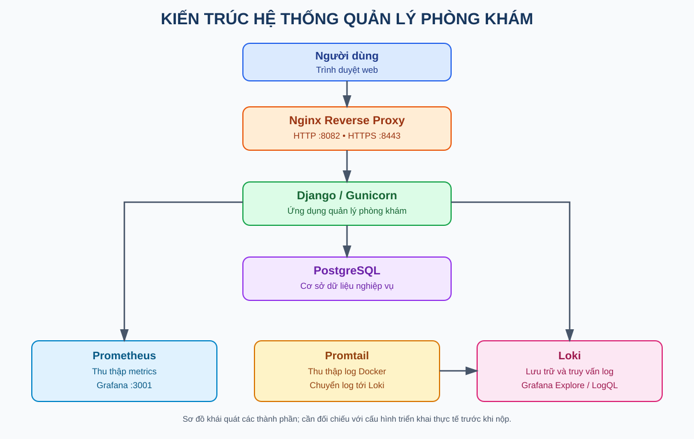

*Hình 2.1. Sơ đồ kiến trúc hệ thống quản lý phòng khám.*

Sơ đồ cần thể hiện luồng truy cập từ trình duyệt đến Nginx, Django/Gunicorn và PostgreSQL; đồng thời thể hiện luồng metrics đến Prometheus, luồng log từ Promtail đến Loki và giao diện Grafana.

## 2.4. Thiết kế dữ liệu

PostgreSQL là hệ quản trị cơ sở dữ liệu quan hệ được sử dụng để lưu trữ dữ liệu của hệ thống quản lý phòng khám. Cấu trúc dữ liệu được triển khai thông qua các model Django và các migration tương ứng.

Cơ sở dữ liệu có các bảng phục vụ nghiệp vụ quản lý bệnh nhân, bác sĩ, lịch hẹn, hồ sơ khám bệnh, đơn thuốc, dịch vụ y tế, hóa đơn và thanh toán. Ngoài ra, hệ thống sử dụng các bảng hỗ trợ tài khoản và phân quyền của Django.

### Sơ đồ quan hệ thực thể (ERD)

Sơ đồ dưới đây được tạo từ cấu trúc PostgreSQL thực tế. Sơ đồ thể hiện các bảng chính và những quan hệ khóa ngoại đã được khai báo trong cơ sở dữ liệu. Không tự bổ sung các bảng hoặc quan hệ chưa được xác nhận.

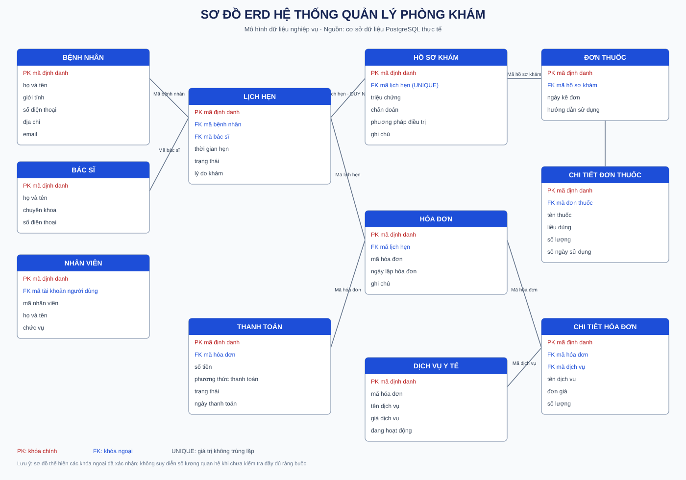

*Hình 2.2. Sơ đồ ERD hệ thống quản lý phòng khám.*

## 2.5. Phân tích chức năng và Use Case

### 2.5.1. Các tác nhân của hệ thống

Căn cứ vào các nhóm quyền được khai báo trong ứng dụng, hệ thống có ba vai trò nghiệp vụ chính: Admin, lễ tân và bác sĩ. Mỗi vai trò được phép thực hiện các chức năng tương ứng với quyền truy cập được cấu hình.

- **Admin:** quản lý nhân viên, quản lý thông tin bác sĩ, quản lý dịch vụ y tế; truy cập các chức năng hóa đơn và thanh toán.
- **Lễ tân:** tra cứu và quản lý bệnh nhân, quản lý lịch hẹn, tra cứu thông tin bác sĩ, hồ sơ khám bệnh và dịch vụ y tế; lập hóa đơn, ghi nhận thanh toán và xem báo cáo.
- **Bác sĩ:** tra cứu bệnh nhân, lịch hẹn và hồ sơ khám; tạo hoặc cập nhật hồ sơ khám bệnh, quản lý đơn thuốc, tra cứu dịch vụ y tế và xem báo cáo.

Các quyền trên được xác định từ các bộ kiểm soát truy cập trong mã nguồn. Tài khoản superuser của Django là trường hợp đặc biệt và không đồng nhất với nhóm Admin thông thường.

### 2.5.2. Các nhóm chức năng chính

Các chức năng của hệ thống được chia thành bốn nhóm:

1. **Quản lý danh mục và nhân sự:** quản lý nhân viên, bác sĩ và dịch vụ y tế.
2. **Quản lý hoạt động khám bệnh:** quản lý bệnh nhân, lịch hẹn, hồ sơ khám bệnh và đơn thuốc.
3. **Quản lý tài chính:** lập hóa đơn, thêm chi tiết hóa đơn và ghi nhận thanh toán.
4. **Theo dõi và tổng hợp:** xem tổng quan dữ liệu và báo cáo nghiệp vụ theo quyền được cấp.

### 2.5.3. Sơ đồ Use Case

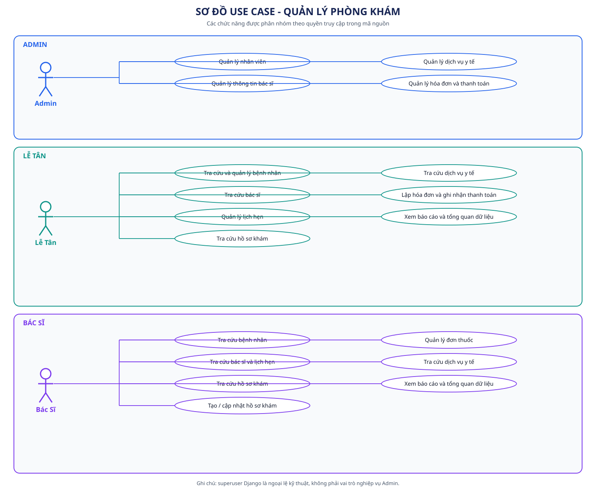

*Hình 2.3. Sơ đồ Use Case hệ thống quản lý phòng khám.*

Sơ đồ Use Case mô tả các chức năng chính của hệ thống theo ba nhóm quyền nghiệp vụ: Admin, lễ tân và bác sĩ. Admin phụ trách quản lý nhân viên, thông tin bác sĩ và dịch vụ y tế; đồng thời được phép thực hiện các nghiệp vụ hóa đơn theo cấu hình quyền. Lễ tân tập trung vào tiếp nhận và quản lý bệnh nhân, lịch hẹn, tra cứu thông tin phục vụ khám bệnh và xử lý hóa đơn, thanh toán. Bác sĩ thực hiện các nghiệp vụ chuyên môn như tra cứu hồ sơ, lập hoặc cập nhật hồ sơ khám và quản lý đơn thuốc. Các chức năng báo cáo và tổng quan dữ liệu được giới hạn theo quyền đã khai báo trong mã nguồn. Tài khoản superuser của Django là cơ chế đặc biệt ở tầng xác thực và phân quyền, không được xem là một vai trò nghiệp vụ độc lập.

## 2.6. Thiết kế triển khai

Docker Compose quản lý các dịch vụ và cấu hình kết nối giữa chúng. Nginx là điểm tiếp nhận truy cập từ bên ngoài; ứng dụng Django xử lý nghiệp vụ; PostgreSQL lưu trữ dữ liệu.

Prometheus thu thập metrics từ các target được cấu hình. Grafana là giao diện trực quan hóa. Promtail chuyển log tới Loki để truy vấn bằng LogQL.

Các địa chỉ cổng được cấu hình trong môi trường triển khai hiện tại:

| Thành phần | Địa chỉ truy cập từ máy host |
|---|---|
| Website HTTP | http://localhost:8082 |
| Website HTTPS | https://localhost:8443 |
| pgAdmin | http://localhost:5050 |
| Prometheus | http://localhost:9091 |
| Grafana | http://localhost:3001 |

Các địa chỉ trên là địa chỉ cục bộ của môi trường triển khai, không mặc nhiên là địa chỉ công khai trên Internet.

# CHƯƠNG 3. XÂY DỰNG VÀ TRIỂN KHAI HỆ THỐNG

## 3.1. Xây dựng ứng dụng web

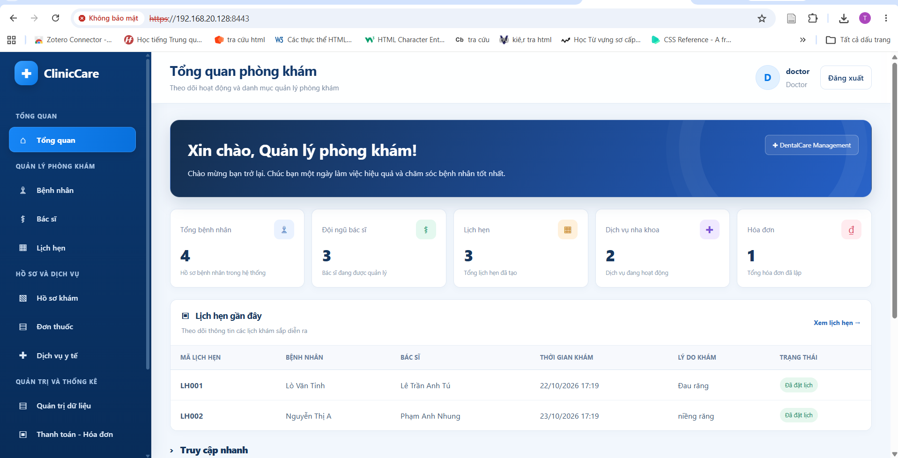

*Hình 3.1. Giao diện hệ thống quản lý phòng khám ClinicCare.*


Django được sử dụng để tổ chức mã nguồn theo các thành phần model, view, form, URL và template. Các model biểu diễn dữ liệu nghiệp vụ; view xử lý yêu cầu; URL ánh xạ đường dẫn đến chức năng tương ứng.

Ứng dụng được chạy bằng Gunicorn trong container web. Nginx tiếp nhận yêu cầu từ người dùng và chuyển tiếp đến ứng dụng. Việc tách Nginx khỏi ứng dụng giúp phân định rõ vai trò tiếp nhận kết nối và xử lý nghiệp vụ.

Các giao diện và chức năng cụ thể trong báo cáo cần được minh họa bằng ảnh chụp trực tiếp từ website đang chạy.

## 3.2. Triển khai PostgreSQL và pgAdmin

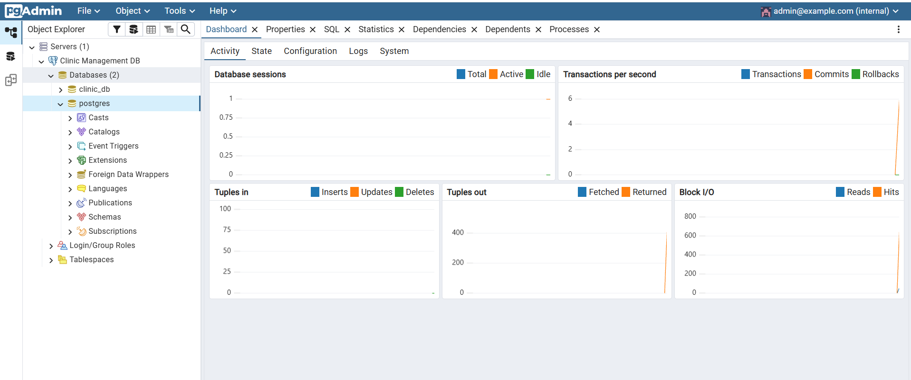

*Hình 3.2. Giao diện quản trị cơ sở dữ liệu bằng pgAdmin.*


PostgreSQL 16 được sử dụng làm cơ sở dữ liệu chính. Docker Compose quản lý container database và thiết lập phụ thuộc sức khỏe dịch vụ trước khi ứng dụng sử dụng cơ sở dữ liệu.

pgAdmin được triển khai thành dịch vụ riêng để hỗ trợ quản trị PostgreSQL bằng giao diện web. Cấu hình cổng truy cập cần đồng bộ giữa cổng bên trong container và cổng được ánh xạ ra máy host.

Trong quá trình vận hành, đã xuất hiện lỗi xác thực PostgreSQL Exporter do thông tin xác thực không khớp. Sau khi đồng bộ mật khẩu tài khoản PostgreSQL theo cấu hình môi trường và tạo lại exporter, log ghi nhận kết nối database thành công.

## 3.3. Docker Compose và mạng dịch vụ

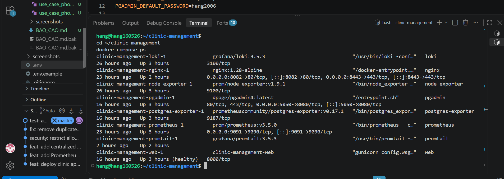

*Hình 3.3. Môi trường phát triển dự án trong VS Code.*


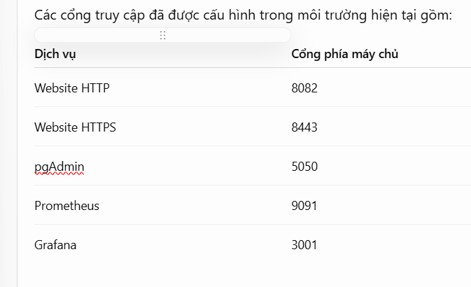

*Hình 3.4. Các cổng truy cập dịch vụ trong môi trường triển khai.*


Các dịch vụ được định nghĩa trong tệp Docker Compose chính và tệp cấu hình giám sát bổ sung. Việc sử dụng nhiều tệp Compose cho phép tách cấu hình ứng dụng khỏi các thành phần quan sát hệ thống.

Các thao tác triển khai cần được thực hiện từ thư mục dự án. Trước khi khởi chạy, cấu hình được kiểm tra bằng lệnh:

```bash
docker compose -f docker-compose.yml \
  -f docker-compose.monitoring.yml config -q
```

Sau đó, trạng thái dịch vụ có thể được kiểm tra bằng:

```bash
docker compose -f docker-compose.yml \
  -f docker-compose.monitoring.yml ps
```

Cần kiểm tra log của từng dịch vụ khi có lỗi khởi động hoặc kết nối. Không xóa các container đang được sử dụng bởi cấu hình Compose khác nếu chưa xác định được quan hệ phụ thuộc.

## 3.4. Reverse proxy và HTTPS

Nginx được triển khai làm reverse proxy, tiếp nhận yêu cầu HTTP và HTTPS rồi chuyển tiếp đến ứng dụng. Cấu hình HTTPS sử dụng chứng chỉ tự ký theo hướng dẫn triển khai của dự án.

Chứng chỉ tự ký phù hợp để thử nghiệm trong môi trường học tập nhưng trình duyệt có thể hiển thị cảnh báo tin cậy. Khi triển khai công khai, cần sử dụng chứng chỉ phù hợp với tên miền và hoàn thiện cấu hình TLS.

Các security headers và thiết lập liên quan cần được kiểm tra trực tiếp trong cấu hình Nginx trước khi khẳng định mức độ bảo vệ thực tế.

## 3.5. Giám sát bằng Prometheus và Grafana

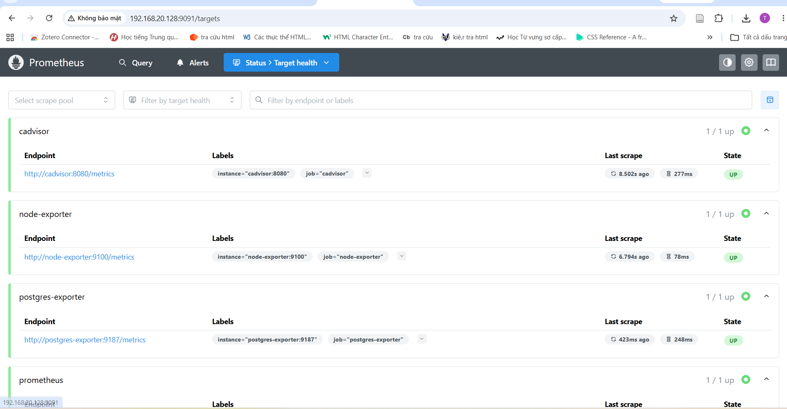

*Hình 3.5. Trạng thái các target giám sát trên Prometheus.*


Prometheus thu thập metrics từ các dịch vụ đã cấu hình. Những thành phần giám sát của dự án gồm Prometheus, Node Exporter, cAdvisor và PostgreSQL Exporter.

Grafana được dùng để truy cập dữ liệu giám sát và hiển thị dashboard. Trạng thái target cần được kiểm tra trong mục Status → Targets của Prometheus.

Trong lần kiểm tra gần nhất, PostgreSQL Exporter đã kết nối thành công với database. Truy vấn Prometheus cho chỉ số `pg_up` trả về giá trị `1`, và target `postgres-exporter` có trạng thái `up`, không có lỗi scrape tại thời điểm kiểm tra.

## 3.6. Tập trung log bằng Loki, Promtail và LogQL

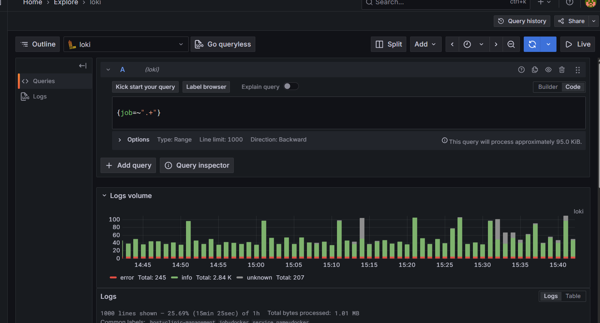

*Hình 3.6. Giao diện Grafana Explore phục vụ truy vấn log.*


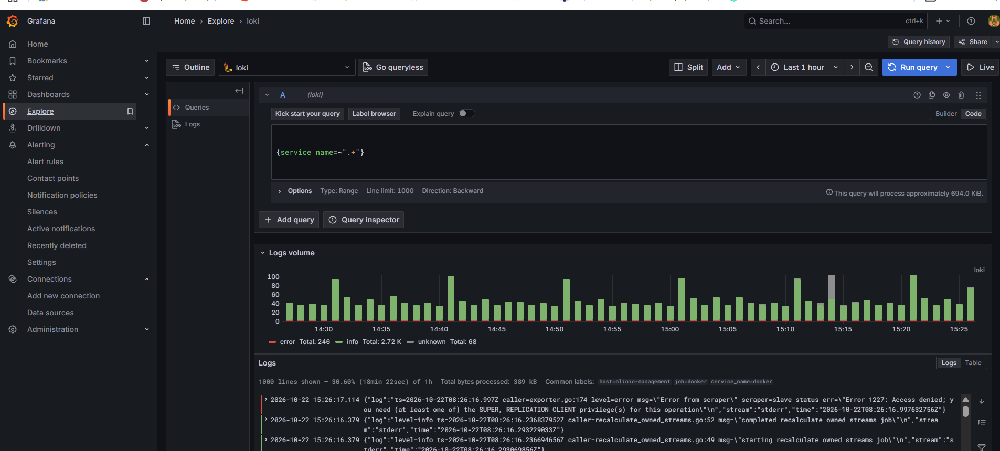

*Hình 3.7. Truy vấn log theo nhãn service_name trên Grafana Explore.*

Ảnh cho thấy Grafana truy vấn được log từ Loki. Một số bản ghi lỗi cũng xuất hiện, do đó cần kiểm tra nội dung log khi đánh giá tình trạng vận hành.

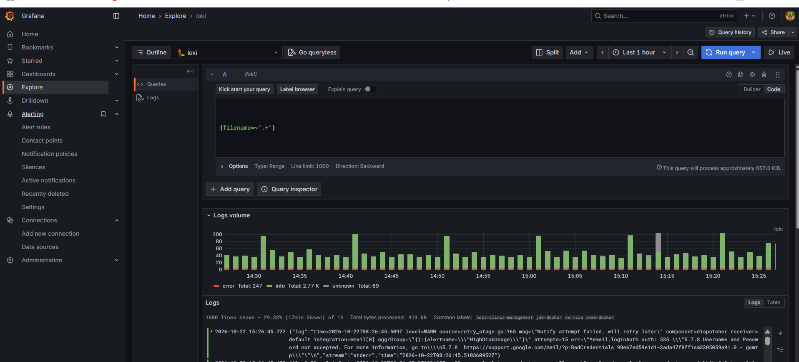

*Hình 3.8. Truy vấn log theo nhãn filename trên Grafana Explore.*

Ảnh minh họa một truy vấn LogQL khác để lọc log theo nhãn filename. Kết quả có cảnh báo gửi email qua SMTP thất bại do xác thực, cần được xem xét riêng.


Promtail chịu trách nhiệm thu thập log theo cấu hình và gửi đến Loki. Grafana cung cấp giao diện Explore để truy vấn log bằng LogQL.

Một số truy vấn có thể sử dụng khi các nhãn tương ứng tồn tại:

```logql
{service=~".+"}
```

```logql
{service="web"}
```

```logql
{service=~".+"} |~ "(?i)error|exception|fatal"
```

Các truy vấn cần được chạy với khoảng thời gian phù hợp. Kết quả phải được đối chiếu với log thực tế; một truy vấn không có kết quả có thể do nhãn hoặc khoảng thời gian chưa phù hợp, không nhất thiết có nghĩa Loki bị lỗi.

Trong lần kiểm tra trước, API Loki trả về trạng thái thành công, danh sách nhãn dịch vụ và các dòng log. Điều này xác nhận đường truy vấn log đã hoạt động tại thời điểm kiểm tra.

## 3.7. Bảo mật và quản lý mã nguồn

Các biện pháp bảo mật và quản lý cấu hình của dự án gồm:

- Đọc cấu hình nhạy cảm từ tệp môi trường.
- Loại trừ `.env` và các tệp không cần thiết khỏi Git.
- Cấu hình `DEBUG` mặc định là `False`.
- Giới hạn `ALLOWED_HOSTS` và khai báo các origin CSRF theo cấu hình.
- Tổ chức mạng backend nội bộ theo thiết kế.
- Sử dụng Nginx làm reverse proxy và cấu hình HTTPS.
- Sử dụng Git để quản lý lịch sử thay đổi và GitHub để lưu trữ mã nguồn.

Đây là các biện pháp đã được cấu hình hoặc thể hiện trong tài liệu dự án. Việc đánh giá đầy đủ yêu cầu hardening vẫn cần kiểm tra thực tế quyền truy cập, chứng chỉ TLS, security headers, cấu hình cookie, quyền container và khả năng bảo vệ dữ liệu.

Không đưa mật khẩu thật, khóa riêng TLS hoặc tệp `.env` vào báo cáo và repository.

# CHƯƠNG 4. KIỂM THỬ, KẾT QUẢ VÀ ĐÁNH GIÁ

## 4.1. Kiểm thử ứng dụng

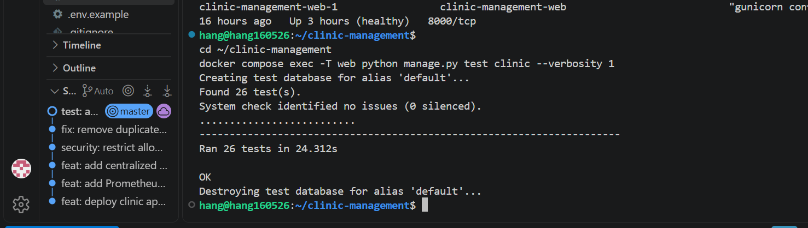

*Hình 4.1. Kết quả chạy bộ kiểm thử tự động của ứng dụng.*


Ứng dụng có bộ kiểm thử tự động trong thư mục `app/clinic/tests/`, gồm các nhóm kiểm thử liên quan đến đăng nhập, quyền truy cập, luồng nghiệp vụ và báo cáo.

Trong một lần chạy đã ghi nhận kết quả:

- Tổng số bài kiểm thử được phát hiện: 26.
- Số bài kiểm thử thành công: 26.
- Số bài kiểm thử thất bại: 0.
- Django system check: không phát hiện lỗi.

Kết quả này phản ánh lần chạy kiểm thử đã được ghi nhận; nên chạy lại bộ kiểm thử ngay trước khi nghiệm thu để xác nhận trạng thái hiện tại.

Lệnh kiểm thử:

```bash
docker compose exec -T web \
  python manage.py test clinic --noinput
```

Lệnh kiểm tra Django:

```bash
docker compose exec -T web python manage.py check
```

## 4.2. Kiểm tra hạ tầng và giám sát

Các kết quả đã được ghi nhận trong quá trình triển khai:

| Hạng mục | Kết quả ghi nhận |
|---|---|
| Cấu hình Docker Compose | Đã vượt qua kiểm tra cấu hình ở lần kiểm tra trước |
| Django | `manage.py check` không phát hiện lỗi ở lần kiểm tra trước |
| Kiểm thử ứng dụng | 26/26 bài kiểm thử thành công ở lần chạy trước |
| Website | Container web hiển thị trạng thái healthy; website đã được xác nhận chạy |
| PostgreSQL | Container database hiển thị trạng thái healthy |
| PostgreSQL Exporter | Kết nối database thành công sau khi đồng bộ thông tin xác thực |
| Prometheus | Target `postgres-exporter` ở trạng thái `up` |
| Chỉ số PostgreSQL | `pg_up = 1` |
| Loki | API nhãn và truy vấn log đã trả về trạng thái thành công ở lần kiểm tra trước |
| Grafana | API health đã trả về HTTP 200 ở lần kiểm tra trước |
| Nginx | Kiểm tra cấu hình `nginx -t` đã thành công ở lần kiểm tra trước |

Các kết quả trên là minh chứng theo những lần kiểm tra đã ghi nhận, không thay thế cho việc chạy lại toàn bộ kiểm thử ở thời điểm nghiệm thu.

## 4.3. Minh chứng triển khai hệ thống

Báo cáo sử dụng các ảnh chụp từ quá trình triển khai để minh họa giao diện ứng dụng, cấu hình dịch vụ và hoạt động giám sát. Các hình ảnh được lưu trong thư mục `report/screenshots/` và được chèn tại những mục nội dung tương ứng.

Các nhóm minh chứng hiện có gồm:

- Giao diện website quản lý phòng khám.
- Giao diện quản trị cơ sở dữ liệu bằng pgAdmin.
- Danh sách cổng truy cập và môi trường triển khai dịch vụ.
- Trạng thái các target trên Prometheus.
- Giao diện Grafana Explore và các truy vấn log bằng LogQL.
- Kết quả kiểm thử tự động của ứng dụng.

Ảnh chụp chỉ phản ánh trạng thái tại thời điểm ghi nhận. Trước khi nộp báo cáo, cần chạy lại bộ kiểm thử và kiểm tra các dịch vụ để xác nhận kết quả hiện tại. Nếu bổ sung ảnh dashboard Grafana, cấu hình HTTPS hoặc kết quả kiểm tra Nginx, cần bảo đảm ảnh thể hiện đúng hệ thống thực tế.

## 4.4. Đánh giá kết quả

### Ưu điểm

- Ứng dụng web và cơ sở dữ liệu được triển khai thành các dịch vụ riêng biệt.
- Docker Compose hỗ trợ tổ chức và quản lý các container.
- Nginx đảm nhiệm vai trò reverse proxy.
- Prometheus, Grafana và các exporter cung cấp nền tảng giám sát metrics.
- Loki và Promtail hỗ trợ tập trung log và truy vấn bằng LogQL.
- Bộ kiểm thử tự động hỗ trợ phát hiện lỗi trong các luồng đã được kiểm thử.
- Git giúp theo dõi thay đổi mã nguồn và hỗ trợ làm việc theo phiên bản.

### Hạn chế

- Chứng chỉ HTTPS tự ký chưa phù hợp để sử dụng công khai như chứng chỉ được cấp bởi CA tin cậy.
- Cấu hình giám sát và dashboard cần được kiểm tra, hoàn thiện theo mục tiêu vận hành thực tế.
- Các biện pháp hardening cần được kiểm tra đầy đủ trước khi triển khai production.

## 4.5. Hướng phát triển

Trong thời gian tiếp theo, hệ thống có thể được phát triển theo các hướng:

- Hoàn thiện kiểm soát quyền truy cập và kiểm thử các vai trò người dùng.
- Bổ sung kiểm thử tích hợp và kiểm thử bảo mật.
- Hoàn thiện dashboard giám sát, cảnh báo khi dịch vụ hoặc database gặp sự cố.
- Chuẩn hóa nhãn log, truy vấn LogQL và quy trình xử lý sự cố.
- Tăng cường bảo vệ bí mật, quản lý chứng chỉ và sao lưu dữ liệu.
- Hoàn thiện tài liệu cài đặt, vận hành, phục hồi và cập nhật hệ thống.

## KẾT LUẬN

Đề tài đã xây dựng nền tảng quản lý phòng khám bằng Django và PostgreSQL, tổ chức triển khai bằng Docker Compose và sử dụng Nginx làm reverse proxy. Hệ thống được tích hợp các công cụ giám sát metrics và tập trung log, gồm Prometheus, Grafana, Loki và Promtail.

Các kết quả đã ghi nhận cho thấy bộ kiểm thử ứng dụng từng đạt 26/26 bài thành công, PostgreSQL Exporter kết nối được cơ sở dữ liệu và Prometheus thu thập thành công chỉ số `pg_up = 1`. Những kết quả này là cơ sở để tiếp tục hoàn thiện tài liệu, bổ sung minh chứng và kiểm tra các yêu cầu bảo mật trước khi nghiệm thu.

Để đưa hệ thống vào môi trường sử dụng thực tế, cần tiếp tục xác minh toàn bộ cấu hình bảo mật, kiểm tra phục hồi dữ liệu, hoàn thiện cảnh báo giám sát và chạy lại bộ kiểm thử trên phiên bản cuối cùng.
